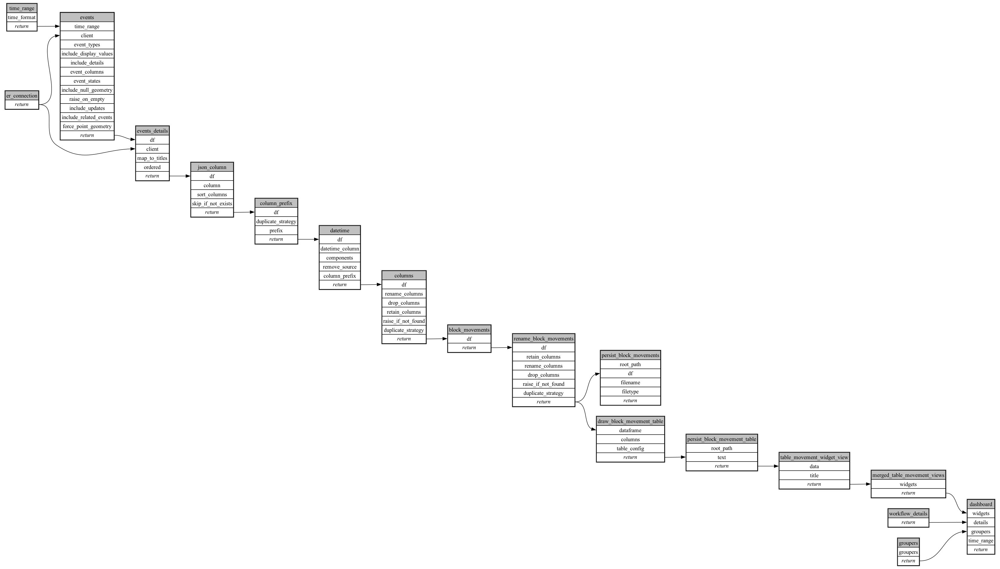

```
# AUTOGENERATED BY ECOSCOPE-WORKFLOWS; see fingerprint in README.md for details

```

```yaml
# fingerprint:
artifacts_sha256_basic: f9ba774d2d47e1bfe346bfb02c71efa21f25e39a755df4a2117f7aedb4dfa7bb
artifacts_sha256_strict: a3ab8d239247deb2a4f86a5ded063514693c64adc424a987850331821ef9f6de
installed_requirements:
- channel: https://repo.prefix.dev/ecoscope-workflows/
  name: ecoscope-platform
  version: {version: ==2.27.1}
- channel: https://repo.prefix.dev/ecoscope-workflows-custom/
  name: ecoscope-workflows-ext-custom
  version: {version: ==0.1.5}
- channel: https://repo.prefix.dev/ecoscope-workflows-custom/
  name: ecoscope-workflows-ext-distance-sample-counts
  version: {version: ==1.1.5}
- channel: conda-forge
  name: pydeck
  version: {version: ==0.9.2}
params_sha256: bbaf2c4e09c40acd1e919c2106abdea89d2371fb17031e221b9f992c2e824517
spec_sha256: a292f5958cd6b5503843604ba1ce9280d079cf8c74caa7dd034756a426a81d85

```

# ecoscope-workflows-dsc-livestock-movement-workflow


